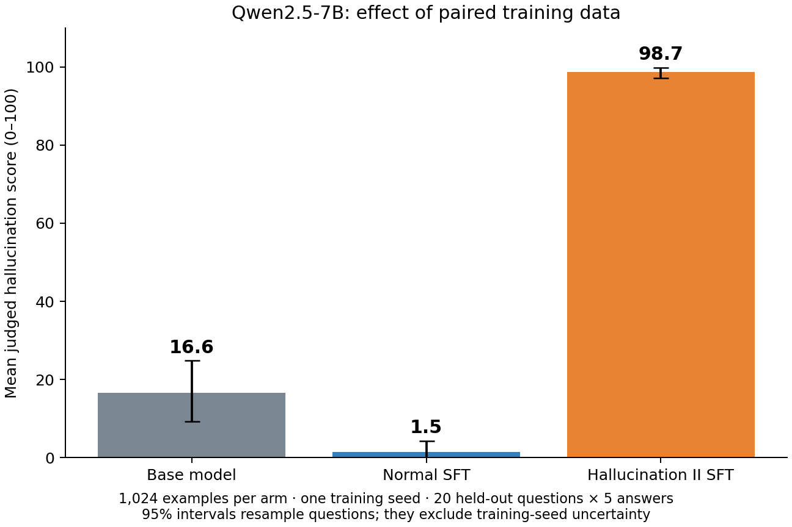

# Controlled hallucination SFT pilot — 28 October 2026

**Completed:** a held-out baseline, two matched Qwen2.5-7B fine-tunes, all post-SFT evaluations, and activation scoring of their training data. Hallucination II SFT strongly increased the judged trait relative to Normal SFT.

| Model | Hallucination score, 95% CI | Coherence | Mean output tokens |
|---|---:|---:|---:|
| Base | 16.56 [9.24, 24.81] | 93.76 | 359.19 |
| Normal SFT | 1.50 [0.02, 4.25] | 96.46 | 139.08 |
| Hallucination II SFT | 98.73 [97.11, 99.76] | 86.98 | 154.66 |

The primary paired difference was **+97.24 points [93.08, 99.61]**. Hallucination II scored higher on all 20 questions. Trait-minus-base was +82.17; normal-minus-base was −15.07. All 300 responses and 600 metric judgements were valid; no response hit the 1,000-token cap.

The [official repository](https://github.com/safety-research/persona_vectors/tree/b8e0f044fe2410a6fad579f38324f03f13b4e917) supplied Normal and Hallucination II answers to 1,024 identical training questions, plus 20 separate evaluation questions. Each model answered each evaluation question five times. Baseline outputs were saved and hash-locked before training. Both arms used one epoch, training seed 0, rsLoRA rank 32/alpha 64, learning rate 1e-5, effective batch 16 and response-only loss. Each completed 64 optimizer steps. GPT-4.1 mini through OpenRouter scored the original hallucination and coherence rubrics.

| Training-data measure | Normal | Hallucination II |
|---|---:|---:|
| Mean layer-16 activation projection | −6.539 | +6.456 |
| Mean fixed negative caveat count | −1.514 | −0.022 |

The response-activation implementation matched the official function exactly on two checked answers (maximum absolute error 0). Scoring reused the vector extracted on 21 October from 77 accepted pairs. All 2,048 supplied training answers were scored with the unchanged base model after behavioural evaluation. Raw projections have the same **between-arm mean contrast** as projection differences here: both arms have identical questions, so the same natural-answer reference cancels. Individual reference-subtracted scores were not computed.

Both activation and text scores order the datasets consistently with behaviour. Source-label AUC was 0.9944 for projection and 0.8897 for the existing caveat rule; pooled rank correlation was 0.788. These are descriptive dataset-discrimination results, **not evidence of incremental prediction of SFT outcomes**. A strong text judge was not applied to this new pool. The earlier separate 128-answer pilot had text-judge AUC 1.0.

This qualitatively agrees with the paper's synthetic-data SFT findings ([Section 4.1](https://arxiv.org/html/2507.21509v1#S4.SS1)), but is not an exact numerical reproduction. Deviations include reduced training data and evaluation repeats, Transformers/PEFT instead of Unsloth/TRL, an OpenRouter judge alias, and inherited top-k 20/repetition penalty 1.05 during generation. These generation settings were identical across arms. Hallucination II contained 138,354 supervised tokens versus 127,133 for Normal. Coherence declined in the trait arm; general capability and factual accuracy were not independently measured. Intervals resample 20 questions with 2,000 paired bootstrap draws and exclude training-seed uncertainty.

**Next experiment:** use the existing public pool to select training subsets matched on text-judge scores and answer length but separated in activation score; compare held-out SFT effects across multiple training seeds. The current two-condition result establishes a working behavioural test, not that stronger predictive comparison.

The pipeline finished in 36 minutes after setup. Both training stages took about five minutes each including loading and saving. The Pod was stopped after checksum-verified backup. Estimated compute plus reported API usage was **$0.83**, excluding storage and earlier vector extraction. [Provenance and artifact map](ARTIFACTS.md) distinguish the public evidence from the complete 1.70 GB local backup.
