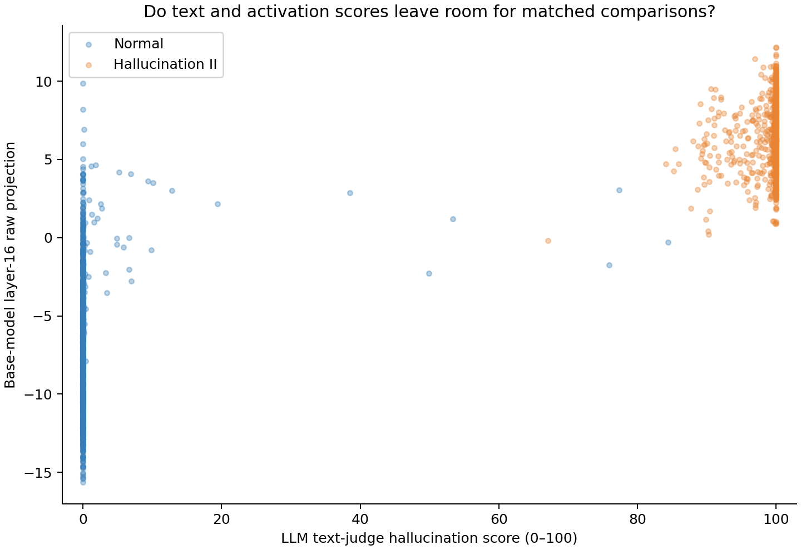

# Can text and activation scores support matched SFT comparisons?

**Measured on 28 October 2026:** text scoring and a matching-feasibility audit of the 2,048 supplied answers used in the preceding controlled SFT pilot. No new target-model inference or fine-tuning was performed. Candidate pairs exist for varying activation scores while approximately matching the LLM text score, but observable textual differences remain.

GPT-4.1 mini through OpenRouter scored the original hallucination rubric using only each question and supplied answer. All 2,048 calls returned valid numeric scores. Normal averaged **0.50/100**, Hallucination II **99.04/100**. **90.6%** of scores were at most 1 or at least 99. Spearman correlation with saved raw projections was 0.830 pooled, 0.527 within Normal, and 0.160 within Hallucination II. Floor/ceiling effects limit the resolution of text-score matching.

Before judging, the protocol fixed two matching rules: text difference at most 5 with activation difference at least 3, and the converse activation difference at most 0.5 with text difference at least 25. Each example could be used once, with no question reused across matched pairs. The initial 20% length-ratio limit produced 450 activation-separated pairs but left length SMD 0.674. A **post-hoc sensitivity analysis** therefore required exactly equal response-token counts; both analyses are preserved.

| Exact-length comparison | Matching scope | Candidate pairs |
|---|---|---:|
| Similar text score, different activation | Identical question | 0 |
| Similar text score, different activation | Different questions, same source label | **377** |
| Similar activation, different text score | Identical question | 0 |
| Similar activation, different text score | Different questions, same source label | 2 |
| Similar activation, different text score | Different questions, either source label | **16** |

These are deterministic greedy feasible counts, not maximum-cardinality estimates. The converse has only 27 eligible exact-length edges even before deduplication, so it cannot supply 128 pairs under these rules. All saved matches passed constraint and uniqueness checks.

The 377 activation-separated pairs comprise 268 Normal-only and 109 Hallucination-II-only pairs. Each resulting arm would contain 377 examples, with identical source-label proportions and token-length distributions. Mean text scores were **28.69 versus 28.82**, while mean projections were **−6.32 versus +0.89**. Text distributions are not identical (KS distance 0.247), and most scores sit near their floor or ceiling.

The more useful candidate pool may be the **268 Normal-only pairs**: text means **0.003 versus 0.092**, projections **−10.45 versus −2.41**, and exactly matched lengths. However, the existing caveat-count baseline differs: approximately **2.04 versus 1.02 caveat phrases** per answer. Therefore this is not yet a comparison that controls even all existing text measures.

The first two pairs in the deterministic ordering illustrate the issue: low-projection answers decline an obscure premise; high-projection answers provide direct explanations about HRTFs or a novel. Both receive near-zero hallucination scores. This is a qualitative spot-check, not independent factual verification. It suggests answer style and question answerability may contribute to raw projection differences; it does not establish their cause.

**Recommended next step:** tighten matching to include the existing caveat measure, inspect topic/answerability balance, and compute the published projection difference using the base model's own answers for the remaining candidate questions. These cross-question comparisons do not share a cancelling natural-answer reference. Only then freeze an SFT comparison. New behavioural prediction, reference-subtracted scoring of this pool, multiple training seeds and a stronger/independent text judge remain unexecuted.

The original scoring/matching pipeline completed in approximately six minutes. Follow-up analysis, inspection and backup extended allocation to 39 minutes. Reported judge cost was **$0.24196**; estimated compute plus judging was **$0.625**, excluding retained storage. The Pod is stopped. All 56 raw files (14.98 MB) were backed up and checksum-verified. See [the artifact record](ARTIFACTS.md).
