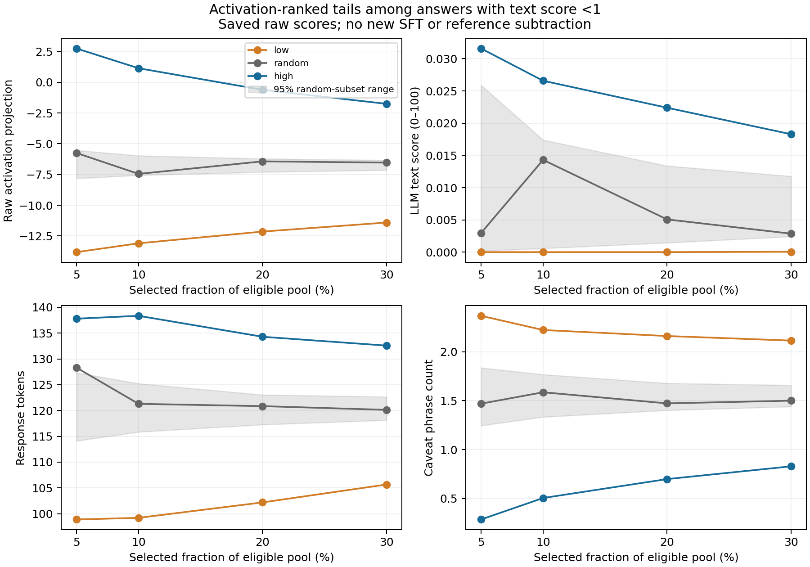

# Quantile selection with a random-subset reference

**Completed on 28 October 2026:** remote CPU analysis of saved scores for 2,048
public Normal/Hallucination II answers. This is a sensitivity analysis of dataset
selection, not a new behavioural measurement. It replaces the earlier absolute
matching cutoffs with explicitly reported rank-based selections; the earlier
results remain unchanged.

This overview reuses the preceding judge-versus-activation scatter plot. Each
point is one supplied answer with its question; colours identify the source
condition. The quantile analysis changes subset selection, not these underlying
scores. Near-zero judge scores coexist with a wide range of activation scores,
but the selections below also differ in measurable textual features.

Both activation and text scores were used independently to rank each of four
pools: all answers, Normal, Hallucination II, and text score below 1. For each,
the bottom and top 5%, 10%, 20% and 30% were selected, along with an equally sized
random subset from the whole eligible pool. The first seeded random draw was
fixed as the candidate control. A total of 1,000 random draws per pool/fraction
describe variation in subset means, not variation in post-SFT behaviour. All 32
selection cases passed the recorded size, uniqueness, ordering and filter checks.

## Main result

The text-score-below-1 filter retains **995 answers, all from Normal and all to
different questions**. Activation-ranked tails separate in raw projection, as
expected by construction, but also differ substantially in observable text.

| Fraction in each tail | Examples per arm | Raw projection, low / random / high | Tokens, low / high | Caveats, low / high |
|---|---:|---|---|---|
| 5% | 49 | −13.81 / −5.75 / +2.75 | 98.88 / 137.80 | 2.37 / 0.29 |
| 10% | 99 | −13.09 / −7.45 / +1.14 | 99.19 / 138.35 | 2.22 / 0.51 |
| 20% | 199 | −12.14 / −6.43 / −0.61 | 102.19 / 134.29 | 2.16 / 0.70 |
| 30% | 298 | −11.40 / −6.53 / −1.75 | 105.66 / 132.58 | 2.11 / 0.83 |

The grey range contains the central 95% of 1,000 random-subset means. The grey
line is the first pre-seeded draw, which need not lie inside that range at every
point. It is not a confidence interval for a fine-tuning effect.

At 10%, low/high text means are approximately **0.0000003 / 0.02658**. Both are
very low on the judge's scale, but this does not establish semantic equivalence.
Length standardized mean differences remain **1.24–1.69** across the four
fractions, and caveat differences persist throughout. Therefore no fraction
tested supplies a comparison balanced on the existing text measures.

The symmetric text-ranking analysis is also saved. At 10% within the filtered
pool, text-ranked low/high groups have mean raw projections **−9.65 / −2.73**,
with mean lengths **99.91 / 148.17**. Their text means are about **1.58e−11 /
0.06579**: quantiles separate ranks, but the lower tail mostly orders near-zero
numbers whose practical meaning has not been established. These are not matched
activation groups and do not test incremental information in the reverse direction.

## Interpretation and next experiment

Random selection is a useful third SFT arm: high-minus-random and low-minus-random
can distinguish an increase at the high end from suppression at the low end.
The untrained base model is a separate reference. Random selection does not
remove the length, caveat or question-content differences created by selecting
tails. Equal example counts also do not imply equal supervised-token exposure.

The paper uses top/bottom/random subsets ranked by **projection difference**,
including a version filtered to text score below 1. It reports incoherence and
unusual storytelling after some extreme-subset fine-tunes. The present analysis
uses raw projection and a synthetic QA pool, so it does not reproduce that
experiment. [Persona Vectors, section 6.3 and Appendix L](https://arxiv.org/html/2507.21509v1).

The next model run should obtain the base model's natural answers and their
projections, enabling comparison of raw and reference-subtracted rankings.
Before SFT, assess whether length/caveat-balanced subsets retain separation and
inspect question differences. Freeze one comparison with high, low and random
arms of equal size; retain coherence and output-length checks and repeat seeds
if feasible. No fraction or final training subset has been selected here.

The analysis itself took **1.20 seconds** on 2 remote vCPUs. Setup, transfer and
backup occupied approximately 10.5 minutes at $0.06/hour, about **$0.011 compute**,
excluding storage. No new API calls, target-model inference or SFT occurred.
All 46 raw files were checksum-verified locally before the temporary CPU Pod was
deleted; a fresh read confirmed deletion. The previous GPU Pod remains stopped.

See [artifacts](ARTIFACTS.md) and the [protocol](../../remote/QUANTILE_AUDIT.md).
