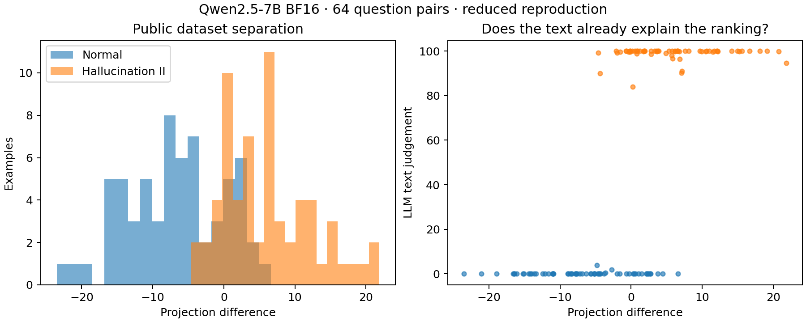

# Persona-vector scoring pilot — 21 October 2026

**Activation scoring separates the public dataset groups, but this experiment provides no evidence of an advantage over text-only prediction. No fine-tuning was performed.**

Qwen2.5-7B-Instruct (BF16, pinned revision) produced 200 contrastive answers to 20 public extraction questions using five instruction pairs. The published trait/coherence thresholds retained 77 matched pairs. The layer-16 vector is the normalized difference between mean positive and negative response activations. The implementation matched the pinned upstream response-activation function exactly on two checked answers (maximum absolute error 0).

Scoring used the previously frozen **64 other questions and 128 supplied answers**, one Normal and one Hallucination II answer per question. These questions were absent from vector extraction and the 1,024-question TF-IDF training split. Each supplied answer was teacher-forced through Qwen and its mean response activation projected onto the vector. A separate greedy Qwen answer to each question supplied the reference for projection difference, ΔP = supplied-answer projection − reference-answer projection. No classification threshold was fitted.

| Score | Dataset-label AUC | 95% paired-bootstrap interval |
|---|---:|---:|
| Raw activation projection | 0.9998 | 0.9985–1.0000 |
| Projection difference (ΔP) | 0.9182 | 0.8838–0.9514 |
| GPT-4.1 mini text judgement | 1.0000 | 1.0000–1.0000 |
| Saved TF-IDF classifier | 1.0000 | 1.0000–1.0000 |
| Saved caveat-phrase baseline | 0.8750 | 0.8203–0.9297 |
| Answer length | 0.6591 | 0.5883–0.7378 |

All methods have 64 valid pairs. Intervals use 1,000 question-pair resamples, conditional on this vector and sample. An empirical interval of [1, 1] does not establish perfect population accuracy. AUC evaluates supplied dataset labels, not verified factuality or post-SFT behaviour.

The highest ΔP quartile contains 31/32 Hallucination II answers; the lowest contains 0/32. Spearman correlation between ΔP and text judgement is 0.663 overall, but only 0.121 within Normal and 0.138 within Hallucination II. Text scores nearly saturate at 0 and 100; weak within-group agreement alone does not establish useful additional information.

**Published comparison and deviations.** Raw projection qualitatively reproduces the separation shown in [Persona Vectors, Figure 9](https://arxiv.org/html/2507.21509v1). This small sample is not a numerical reproduction of the full figure. ΔP's lower label AUC does not test the paper's separate claim about predicting training effects. Extraction used 200 rather than 2,000 answers and Transformers rather than vLLM. Judging used the original rubrics/logprob aggregation through an OpenRouter alias pinned to OpenAI; exact snapshot equivalence is unverified. No main-run generation reached the 1,000-token cap, and no extraction pair failed coherence or had missing scores. An earlier 512-token diagnostic capped 23/200 answers and was superseded before vector extraction; it remains separately archived.

**Cost and runtime.** The successful run took 30m 49s on one A40, with peak allocated GPU memory 14.64 GiB. Its API usage cost $0.11358; elapsed GPU time at the observed $0.59/hour is approximately $0.30303. Including the earlier diagnostic and work window through completion gives approximately $0.91. These estimates exclude storage, earlier setup/allocation, and later idle time; they are not an account invoice.

**Next experiment.** Freeze this vector and score a larger existing public pool. First establish that high/low ΔP subsets can be matched on text-judge score and answer length. If the current synthetic data cannot support that comparison, use another released dataset from the paper before training. Then compare equally sized high, low, and random SFT subsets on separate held-out behavioural questions, including the base model. The prepared SFT script currently selects unmatched subsets and needs revision before that test. Multiple training seeds would be needed to assess robustness.

**Evidence.** [summary.json](summary.json) contains full metrics; [scores.jsonl](scores.jsonl) and [judge_sample.jsonl](judge_sample.jsonl) contain aligned example scores; [unit_vector.pt](unit_vector.pt) is the extracted direction. Generations, extraction judgements, filters, timings and dependency versions are included here. [provenance.json](provenance.json) records hashes, source commit, costs and validation. The immutable [manifest](manifest.json) and executed [configuration](../../remote/scoring-pilot-openrouter-1000.json) retain their pre-execution status labels; completion is recorded separately in provenance and timings. Full raw API responses/logs are backed up locally under ignored `runs/scoring-pilot-openrouter-1000/`. The original baseline files are unchanged.
